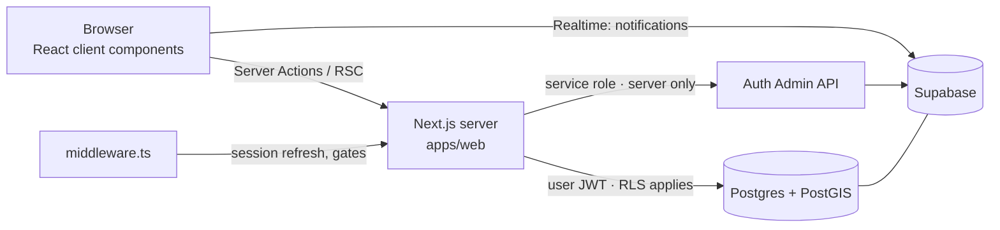

# Architecture (Phase 1)

## Security model

| Layer | What it does |
|---|---|
| **Postgres RLS** | Every table has RLS. RBAC/audit tables are read-only to clients; writes go through `SECURITY DEFINER` RPCs. |
| **`has_permission(key)`** | Active user + token issued after any forced sign-out + aal2 for staff (when `security.staff_mfa_required`) + a role granting the key (or `grants_all`). Permissions are always read from the DB — the JWT only carries role ids / district ids / kind. |
| **Admin RPCs** | `admin_*` functions check the permission, block privilege escalation (perms, data scope, Super Admin role, districts), protect the last Super Admin (deferred constraint trigger), forbid self-demotion/deletion, and write a summarised audit event. |
| **Server Actions** | Validate with the shared Zod schema, call the RPC as the user, then the Auth Admin API with the service role, then the RPC that records the DB side. Failures roll back (e.g. auth user deleted if provisioning fails). |
| **Middleware** | Locale routing, session refresh, suspended → sign out, `must_change_password` → `/change-password`, staff without aal2 → `/mfa`, idle timeout, JWT refresh when roles changed. UX only — security is in the DB. |

## Key flows

- **Create user**: `idempotency_begin` → `admin_validate_user_grants` → `auth.admin.createUser` (or invite) → `admin_provision_user` (profile + roles + districts + audit) → `idempotency_finish`. Any failure deletes the auth user.
- **Suspend**: `admin_authorize_user_action` → ban in Auth → `admin_apply_user_action` (status, `sessions_revoked_at`, refresh tokens deleted, audit, notification). Existing access tokens stop working immediately because `has_permission` compares `iat` with `sessions_revoked_at`.
- **Login lockout**: 5 failed attempts per email within 15 min (from `login_events`) → locked; checked by `auth_login_precheck` (service role) before `signInWithPassword`.
- **Errors**: RPCs raise `CODE: detail`; `unwrap()` maps to `AppFailure(code)`; the UI shows `errors.codes.<CODE>` in Somali/English plus a request id that also appears in the server log and `audit_log.request_id`.

## Data model added in Phase 1

`regions`, `districts` (base for Phase 2), `profiles`, `roles`, `permissions`, `role_permissions`, `user_roles`,
`user_districts`, `login_events`, `settings`, `jobs`, `notifications`, `idempotency_keys`, `audit_log`,
`private.user_record_tables` (legal/financial tables register here so hard delete is blocked).
